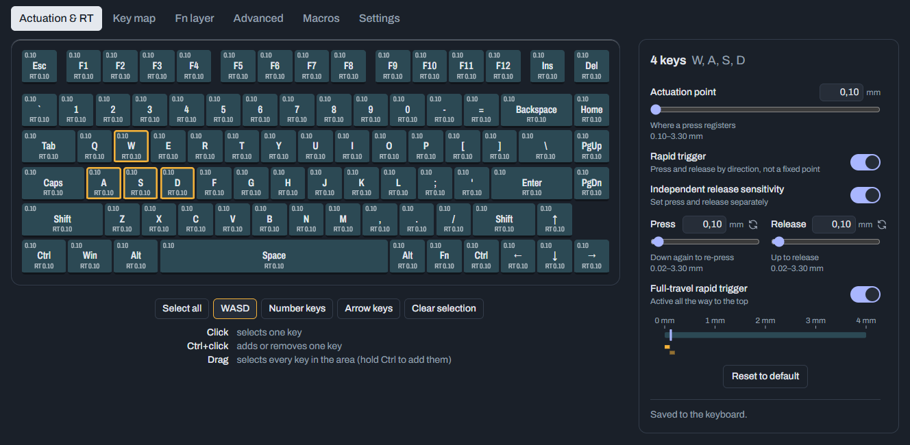
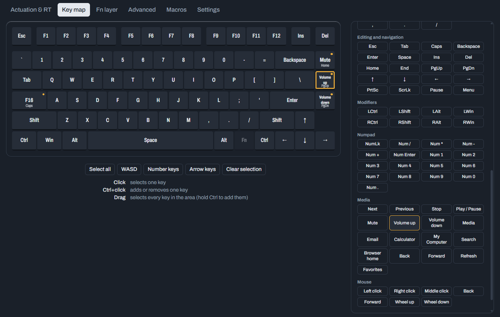
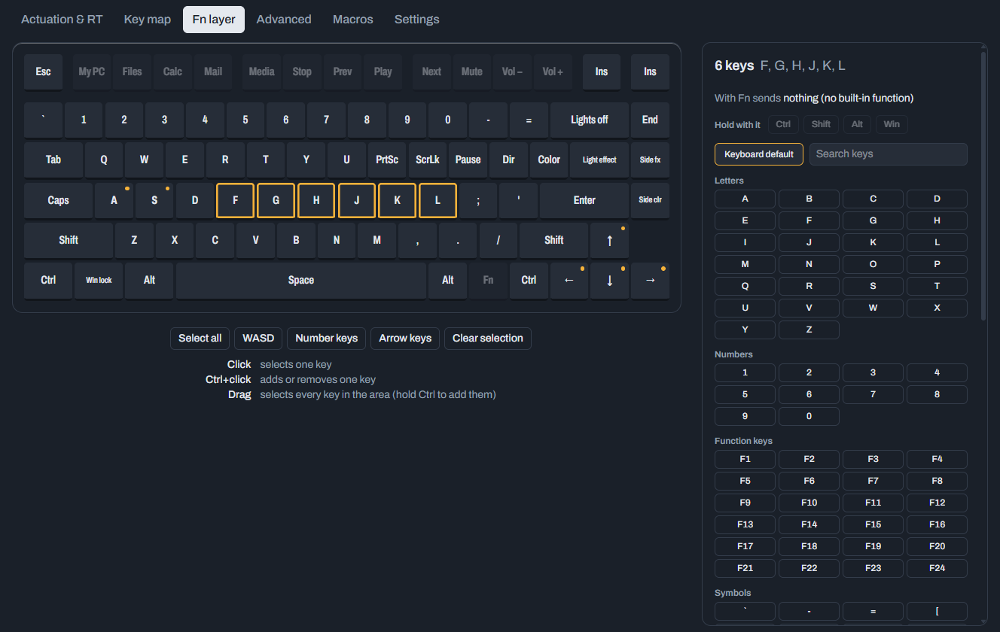
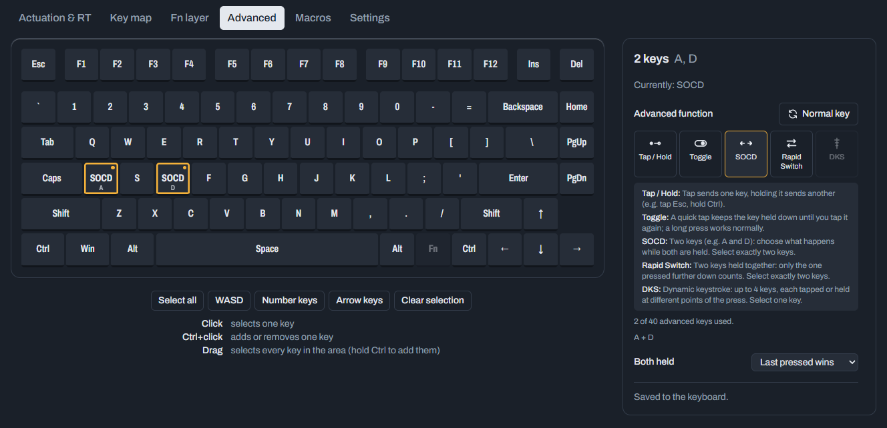
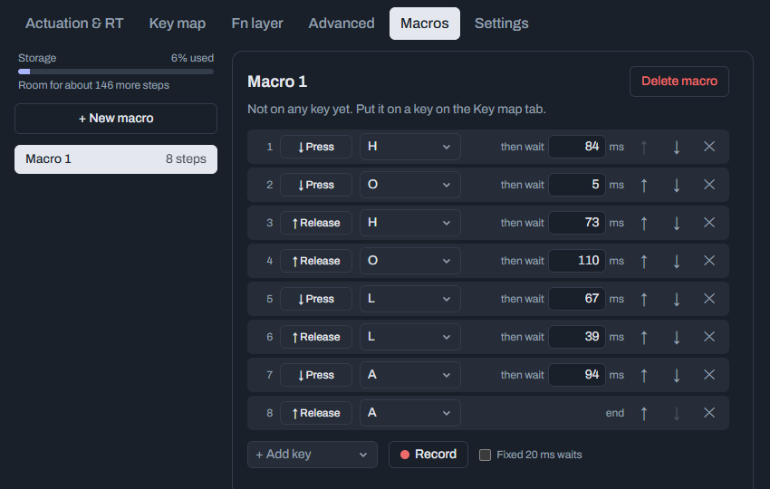

# EPOMAKER HE80 Web Driver

[](https://github.com/abdeljalal99/he80-web-driver/actions/workflows/test.yml)
[](LICENSE)

An unofficial, open-source driver for the **Epomaker HE80** magnetic (Hall effect) keyboard that runs in your browser.
Tune actuation and rapid trigger per key, remap keys, set up advanced keys and macros, and keep backups of your
setup, without installing anything.



**Try it: [abdeljalal99.github.io/he80-web-driver](https://abdeljalal99.github.io/he80-web-driver/)** (Chrome or Edge;
no keyboard? use *Open backup file* with the backup in `web/test/`).

> **Unofficial project.** Not affiliated with or endorsed by Epomaker. It talks to the keyboard with the same protocol
> as the official web driver and was tested on a real HE80 (firmware 1.08), but use it at your own risk and keep
> backups (the driver makes them for you).

## Features

- **Actuation & rapid trigger** per key: actuation 0.10–3.30 mm, rapid trigger with separate press/release
  sensitivity down to 0.02 mm, full-travel rapid trigger. Keys are shaded by depth so you can see your setup at a glance.
- **Key map and Fn layer**: remap to any key, media key or mouse button, or to a **shortcut on a single key**
  (e.g. Win+E or Ctrl+C), a feature the official driver doesn't offer.
- **Advanced keys**: Tap/Hold, Toggle, SOCD, Rapid Switch and **DKS** (dynamic keystroke: up to 4 keys at 4 points
  of the key press) with a visual stage editor.
- **Macros**: step editor, **recording by typing** with real timing, play N times or until pressed again.
- **Settings**: polling rate up to 8 kHz, stability mode, adaptive calibration, reset to defaults.
- **Backups**: save your whole setup to a file and restore it with a preview of what will change. Backup files work
  as profiles. An automatic backup is kept in the browser every time the keyboard is read.
- **Safe by design**: only known-safe commands can be sent (no firmware, bootloader, calibration or factory-reset
  commands), unknown bytes are written back unchanged, and every write is verified by reading it back.
- Auto-save, multi-key selection (click, Ctrl+click, drag), light / dark / system theme.

| Key map | Fn layer |
|---|---|
|  |  |
| **Advanced keys** | **Macros** |
|  |  |

## Getting started

Requirements: a Chromium browser (Chrome, Edge, Brave, Opera) and [Node.js](https://nodejs.org) 22 or newer.

```sh
cd web
npm install
npm run dev
```

Open the printed `localhost` address, close the official Epomaker hub if it's open (only one app can talk to the
keyboard at a time), and click **Connect keyboard**.

No HE80? Click **Open backup file** and pick `web/test/he80-backup-*.json` to explore the whole app with a real
keyboard's settings (read-only).

### Hosting it

```sh
cd web
npm run build      # static files in web/dist
```

Serve `web/dist` with any static web server, at a domain root or in a subfolder (e.g. GitHub Pages); asset paths are
relative. WebHID only works in a secure context, so the page must be served over **HTTPS** (or opened on `localhost`).

### Development

```sh
npm test           # unit tests (protocol, backups, advanced keys, macros), incl. checks against a real HE80 backup
npm run lint
npm run build      # type-check and production build
```

## What doesn't work (firmware 1.08)

Macros on the Fn layer, the macro mode "while held", dead zones and a live key-travel view aren't supported by the
keyboard's firmware, so the driver doesn't offer them. Lighting isn't covered. Details and the reasons are in the
technical reference.

## How it works

The HE80 stores everything in a few memory regions (settings, key map, Fn layer, per-key travel, DKS slots, macros)
that are read and written over a vendor HID interface in 64-byte packets. The driver reads every region on connect,
edits a copy and writes back only what changed.

**[docs/TECHNICAL.md](docs/TECHNICAL.md)** documents everything: features and limitations, the safety design, the
complete protocol (packet format, command table, every region's byte layout, advanced keys, macros), the key index
map, what was verified on hardware, the firmware situation, and how it was worked out, so you can extend it or port
it to a related keyboard.

## Project structure

```
web/          the driver (React 19 + TypeScript + Vite + Tailwind CSS)
  src/lib/    protocol, transport and logic, no UI code; unit tested
  src/ui/     React components (one editor per tab)
  test/       a real HE80 backup used as a test fixture
docs/         technical reference and screenshots
```

## License

[MIT](LICENSE)
